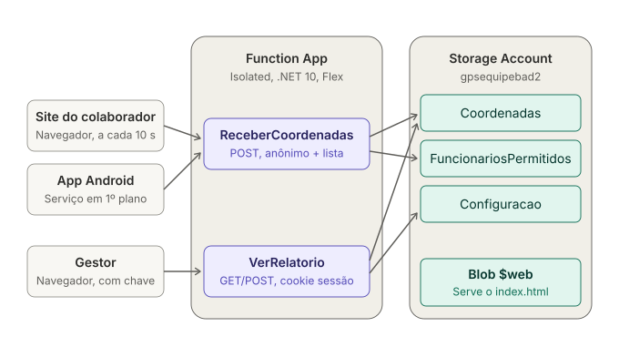
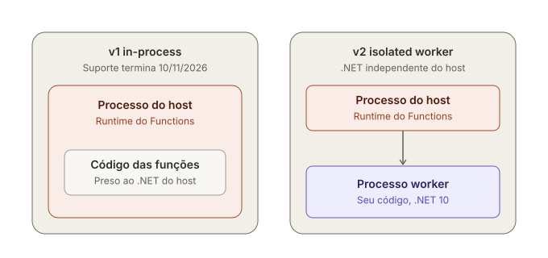
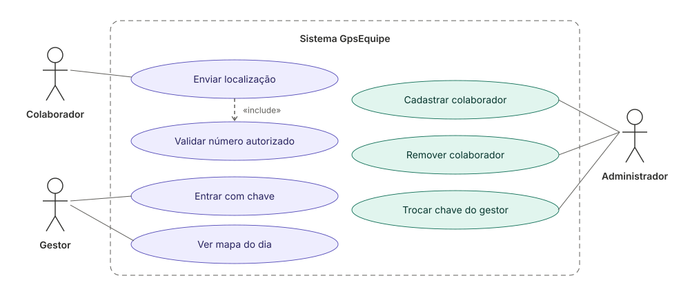
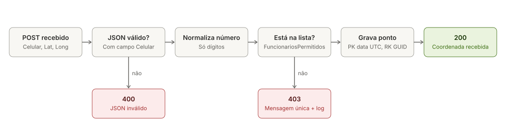
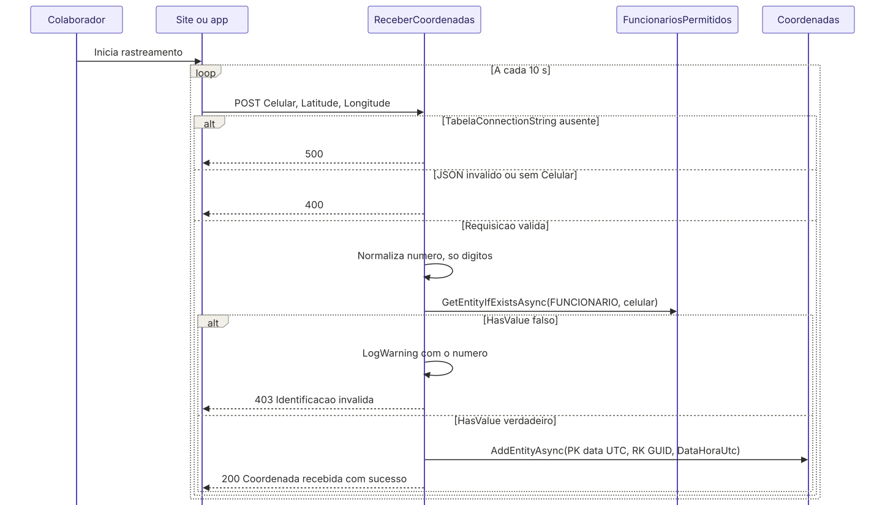
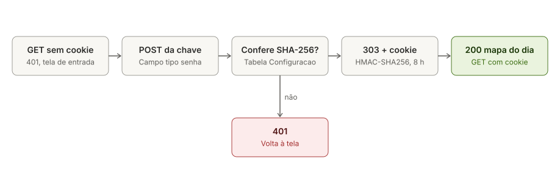
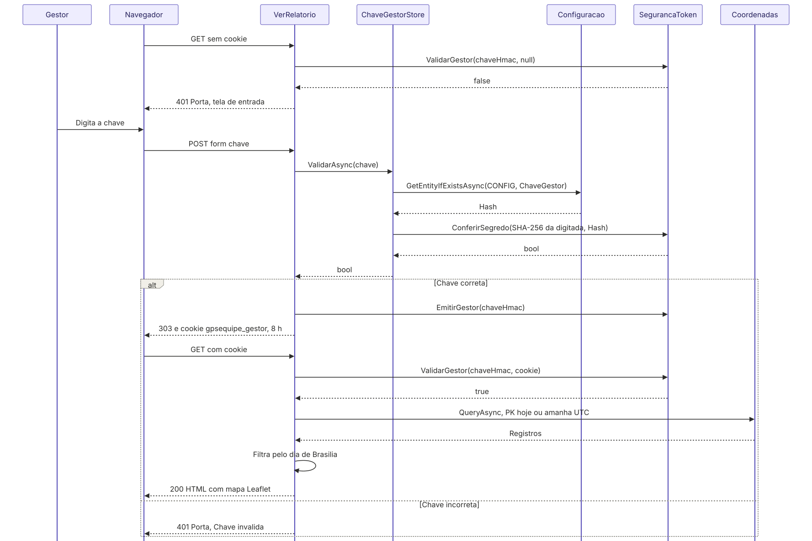

# GpsEquipe

Sistema de rastreamento de localização de colaboradores em campo, construído
sobre arquitetura serverless no Microsoft Azure.

Projeto acadêmico de extensão. Engenharia de Software, Cruzeiro do Sul / UNICID.
Reconstrução de uma versão anterior, migrada do modelo *in-process* do Azure
Functions para o modelo **isolated worker**.

---

## O que o sistema faz

O colaborador abre uma página no navegador do celular, informa o próprio número e
toca em **Iniciar rastreamento**. A página envia a coordenada do GPS a cada 10
segundos. A API confere o número contra a lista de autorizados e grava o ponto.

Para envio com a tela apagada, há também um app Android nativo (pasta pp/), que manda o mesmo dado para a mesma API e só para quando o colaborador toca em DESLIGAR.

O gestor abre o relatório, digita a chave de acesso numa tela e vê, num mapa, os
pontos e o trajeto de cada número no dia corrente (horário de Brasília).

O cadastro de colaboradores é feito pela linha de comando, direto na tabela.

A página mostra ao colaborador um aviso curto sobre o tratamento dos dados. Ele diz o que é enviado, quando o envio pausa, quem vê os pontos e como pedir a exclusão.

---

## Arquitetura

```
Navegador do colaborador
  │  POST /api/recebercoordenadas   (JSON: Celular, Latitude, Longitude)
  ▼
Azure Functions (isolated worker, .NET 10, Flex Consumption)
  ├── ReceberCoordenadas   HTTP  anônimo  → confere a lista e grava a coordenada
  └── VerRelatorio         HTTP  anônimo  → tela de entrada e mapa do dia
  │
  ▼
Azure Table Storage
  ├── Coordenadas             PartitionKey = data UTC (yyyy-MM-dd), RowKey = GUID
  ├── FuncionariosPermitidos  PartitionKey = "FUNCIONARIO", RowKey = celular (só dígitos)
  └── Configuracao            PartitionKey = "CONFIG", RowKey = "ChaveGestor" (hash)

Azure Blob Storage ($web)
  └── index.html   site do colaborador
```

| Recurso | Nome | Configuração |
| --- | --- | --- |
| Resource Group | `GpsEquipe-RG` | brazilsouth |
| Storage Account | `gpsequipebad2` | Standard_LRS, StorageV2, TLS 1.2, sem blob público |
| Function App | `GpsEquipe-App-bad2` | Flex Consumption, 512 MB, HTTPS apenas, sem Application Insights |
| Site do colaborador | `https://gpsequipebad2.z15.web.core.windows.net/` | site estático do storage |
| Relatório do gestor | `https://gpsequipe-app-bad2.azurewebsites.net/api/verrelatorio` | — |

Hospedado numa assinatura Visual Studio Professional, cujo crédito mensal é
destinado a desenvolvimento e teste.

---

## Diagramas

Todos os diagramas abaixo estão também reunidos em
[`docs/GpsEquipe_Diagramas.pdf`](docs/GpsEquipe_Diagramas.pdf), em A4 paisagem
e formato vetorial, para apresentação. Clique numa imagem para abri-la em
tamanho real.

### Arquitetura geral

Clientes, funções do Azure Functions e tabelas do Table Storage.



### Modelo de execução: in-process × isolated worker

Na v1, o código das funções rodava dentro do processo do host. Na v2, o host e
o worker com o código são processos separados, e o worker usa .NET 10.



### Caso de uso



### Diagrama de classe

Membros conforme o código-fonte. `$` marca membro estático.



### Envio de coordenada





### Acesso do gestor





As fontes Mermaid do diagrama de classe e dos diagramas de sequência estão em
`docs/diagramas/fontes/`.

---

## Estrutura do repositório

| Arquivo | Conteúdo |
| --- | --- |
| `Program.cs` | host do worker isolado |
| `Entidades.cs` | `CoordenadaEntidade` e `FuncionarioPermitidoEntidade` (`ITableEntity`) |
| `ReceberCoordenadas.cs` | HTTP POST: confere o número na lista e grava a coordenada |
| `VerRelatorio.cs` | HTTP GET/POST: tela de entrada do gestor e mapa do dia |
| `SegurancaToken.cs` | sessão do gestor: token assinado com HMAC-SHA256 e comparação em tempo constante |
| `ChaveGestorStore.cs` | valida a chave do gestor contra o hash guardado na tabela `Configuracao` |
| `index.html` | site do colaborador (captura e envio do GPS) |
| `host.json` | configuração do host do Functions |
| `GpsEquipe.csproj` | projeto .NET |
| `docs/diagramas/` | diagramas em SVG e fontes Mermaid |
| `docs/GpsEquipe_Diagramas.pdf` | diagramas reunidos para apresentação |

`local.settings.json` está fora do versionamento.

---

## Endpoints

| Endpoint | Método | Autorização |
| --- | --- | --- |
| `/api/recebercoordenadas` | POST | anônimo, protegido pela lista `FuncionariosPermitidos` |
| `/api/verrelatorio` | GET, POST | anônimo, protegido por cookie de sessão do gestor |

As duas rotas anônimas não são abertas: a proteção está no código, não na
plataforma.

### Enviar coordenada

```json
POST /api/recebercoordenadas
{ "Celular": "+5599000000001", "Latitude": -23.5505, "Longitude": -46.6333 }
```

| Resposta | Quando |
| --- | --- |
| `200` `Coordenada recebida com sucesso.` | número cadastrado |
| `403` `Identificacao invalida.` | número fora da lista |
| `400` | JSON inválido ou sem `Celular` |
| `500` | app setting `TabelaConnectionString` ausente |

O número é normalizado para só dígitos antes da consulta: `+55 (99) 0000-00001`
e `5599000000001` são o mesmo colaborador.

**Falha fechada com mensagem única.** Toda falha de identificação devolve o
mesmo `403` com o mesmo texto. Mensagens distintas transformariam o endpoint em
oráculo de quem é colaborador. O número recusado vai para o log.

### Entrar no relatório

```
GET  /api/verrelatorio                        -> 401 com a tela de entrada
POST /api/verrelatorio   (form: chave=...)    -> 303 + cookie de sessão
GET  /api/verrelatorio   (com o cookie)       -> 200 com o mapa
```

O cookie é `HttpOnly`, `Secure`, `SameSite=Strict` e vale por 8 horas. O campo
da chave é do tipo senha, para não aparecer em tela nem em gravação.

---

## Requisitos

- .NET SDK 10
- Azure Functions Core Tools 4
- Azure CLI 2.x
- Assinatura Azure com permissão para criar Storage Account e Function App

Target framework: `net10.0`. Pacotes, conforme o `.csproj`:

| Pacote | Versão |
| --- | --- |
| `Azure.Data.Tables` | 12.12.0 |
| `Microsoft.Azure.Functions.Worker` | 2.52.0 |
| `Microsoft.Azure.Functions.Worker.OpenTelemetry` | 1.2.0 |
| `OpenTelemetry.Extensions.Hosting` | 1.15.3 |
| `Azure.Monitor.OpenTelemetry.Exporter` | 1.7.0 |
| `Microsoft.Azure.Functions.Worker.Extensions.Http.AspNetCore` | 2.1.0 |
| `Microsoft.Azure.Functions.Worker.Sdk` | 2.0.7 |

---

## Provisionamento

```powershell
# 1. Resource Group
az group create --name GpsEquipe-RG --location brazilsouth

# 2. Storage Account (nome global, 3-24 chars, minúsculas e dígitos)
az storage account create --name gpsequipebad2 --resource-group GpsEquipe-RG `
  --location brazilsouth --sku Standard_LRS --kind StorageV2 `
  --min-tls-version TLS1_2 --allow-blob-public-access false --https-only true

# 3. Tabelas
foreach ($t in 'Coordenadas','FuncionariosPermitidos','Configuracao') {
  az storage table create --name $t --account-name gpsequipebad2 --auth-mode key
}

# 4. Function App (.NET 10 exige Flex Consumption no Linux)
az functionapp create --name GpsEquipe-App-bad2 --resource-group GpsEquipe-RG `
  --storage-account gpsequipebad2 --flexconsumption-location brazilsouth `
  --runtime dotnet-isolated --runtime-version 10.0 --instance-memory 512 `
  --disable-app-insights true
az functionapp update --name GpsEquipe-App-bad2 --resource-group GpsEquipe-RG `
  --set httpsOnly=true

# 5. App settings, sem exibir valores no console
& {
  $cs = az storage account show-connection-string --name gpsequipebad2 `
    --resource-group GpsEquipe-RG --query connectionString -o tsv
  $b = New-Object byte[] 32
  $g = [System.Security.Cryptography.RandomNumberGenerator]::Create(); $g.GetBytes($b); $g.Dispose()
  $h = [Convert]::ToBase64String($b)
  az functionapp config appsettings set --name GpsEquipe-App-bad2 --resource-group GpsEquipe-RG `
    --settings "TabelaConnectionString=$cs" "TokenChaveHmac=$h" -o none
  $cs = $null; $h = $null; $b = $null
}

# 6. Site estático e CORS restrito à origem dele
az storage blob service-properties update --account-name gpsequipebad2 `
  --static-website --index-document index.html --auth-mode key
az functionapp cors add --name GpsEquipe-App-bad2 --resource-group GpsEquipe-RG `
  --allowed-origins "https://gpsequipebad2.z15.web.core.windows.net"
```

### App settings usados pela aplicação

| Nome | Para quê |
| --- | --- |
| `TabelaConnectionString` | acesso ao Table Storage |
| `TokenChaveHmac` | assina e verifica a sessão do gestor (32 bytes em Base64) |

### Chave de acesso do gestor

A tabela `Configuracao` guarda só o SHA-256 da chave. Para criar ou trocar a
chave, gere uma nova, grave o hash e entregue a chave ao gestor. Ela vai para a
área de transferência e não aparece no console.

```powershell
& {
  $b = New-Object byte[] 32
  $g = [System.Security.Cryptography.RandomNumberGenerator]::Create(); $g.GetBytes($b); $g.Dispose()
  $k = [Convert]::ToBase64String($b).TrimEnd('=').Replace('+','-').Replace('/','_')
  $s = [System.Security.Cryptography.SHA256]::Create()
  $h = [Convert]::ToBase64String($s.ComputeHash([Text.Encoding]::UTF8.GetBytes($k))); $s.Dispose()
  az storage entity insert --account-name gpsequipebad2 --table-name Configuracao --auth-mode key `
    --entity PartitionKey=CONFIG RowKey=ChaveGestor "Hash=$h" --if-exists replace -o none
  $k | Set-Clipboard
  Write-Output 'Chave do gestor na area de transferencia. Guarde num cofre.'
  $k = $null; $h = $null; $b = $null
}
```

Trocar a chave não reinicia a aplicação: é escrita em tabela, não em app setting.

---

## Deploy

```powershell
func azure functionapp publish GpsEquipe-App-bad2

az storage blob upload --account-name gpsequipebad2 --container-name '$web' `
  --file index.html --name index.html --content-type 'text/html; charset=utf-8' `
  --overwrite --auth-mode key
```

## Cadastrar e remover colaborador

```powershell
# Cadastrar (só dígitos, com código do país e DDD)
az storage entity insert --account-name gpsequipebad2 --table-name FuncionariosPermitidos `
  --auth-mode key --entity PartitionKey=FUNCIONARIO RowKey=5599000000001

# Remover
az storage entity delete --account-name gpsequipebad2 --table-name FuncionariosPermitidos `
  --auth-mode key --partition-key FUNCIONARIO --row-key 5599000000001
```

Remover o cadastro bloqueia novos envios. As coordenadas já gravadas continuam
na tabela `Coordenadas`.

---

## App Android (pasta `app/`)

Cliente nativo em C# (.NET for Android), versão 3.0, mínimo Android 7 (API 24).
O navegador pausa a página com a tela apagada; o app usa um serviço em primeiro
plano, com notificação fixa, e envia o mesmo JSON do site para
`/api/recebercoordenadas`. O backend não muda.

| Comportamento | Como funciona |
| --- | --- |
| Número confirmado | ao tocar em LIGAR, o app pede confirmação do número formatado; depois, mostra o número em destaque e esconde o campo |
| Envio visível | faixa ENVIANDO (verde, envio aceito nos últimos 30 s), LIGADO, AGUARDANDO ENVIO (laranja) ou DESLIGADO (vermelho); abaixo, total de envios, horário do último, última posição e resposta do servidor |
| Só para no botão | o envio desliga apenas em DESLIGAR, com confirmação; o `403` avisa e continua tentando |
| Religamento | o serviço volta sozinho depois de o app ser removido dos recentes, de ser encerrado pelo sistema e de o celular reiniciar |
| Posição | Fused Location do Google Play Services, alta precisão a cada 10 s; sem Play Services, usa GPS e rede pelo `LocationManager` |
| Filtro | posição com erro acima de 100 m é descartada |
| Diagnóstico na tela | fonte da posição, ciclos sem posição, posições descartadas e inícios do serviço, com horário |
| Bateria | botão que abre o pedido do Android para isentar o app da otimização de bateria |

| Arquivo | Conteúdo |
| --- | --- |
| `app/MainActivity.cs` | tela, permissões, confirmação do número, estado e diagnóstico |
| `app/RastreioService.cs` | serviço em primeiro plano: posição, envio a cada 10 s, um envio por vez, religamento |
| `app/BootReceiver.cs` | religa o envio depois de reiniciar o celular, se ele estava ligado |
| `app/GpsEquipeApp.csproj` | projeto `net10.0-android`, pacote `Xamarin.GooglePlayServices.Location` 121.4.0.1 |
| `app/Directory.Build.props` | caminhos locais do Android SDK e do JDK |

Requisitos: workload `android` do .NET, JDK 17 e Android SDK, instalado pelo alvo
`InstallAndroidDependencies`.

```powershell
dotnet publish app\GpsEquipeApp.csproj -c Release -f net10.0-android `
  -p:AndroidPackageFormat=apk -o app\saida
```

O APK é instalado fora da loja.
---

## Decisões de projeto

**Isolated worker.** O suporte ao modelo in-process do .NET no Azure Functions
termina em 10/11/2026. Esta versão nasceu no modelo isolado, com o código
portado: `[FunctionName]` → `[Function]`, host em `Program.cs` e HTTP trigger
sobre a integração ASP.NET Core (`HttpRequest` e `IActionResult`).

**.NET 10 em Flex Consumption.** O .NET 8 e o .NET 9 perdem suporte em
10/11/2026. O .NET 10 é LTS, mas não roda no plano Linux Consumption: o deploy
conclui e a sincronização de gatilhos falha. O plano Flex Consumption aceita o
.NET 10 e é o substituto indicado para o Linux Consumption, que encerra em
30/09/2028.

**Particionamento por data.** `PartitionKey` é a data UTC do envio, no formato
`yyyy-MM-dd`. O mapa do dia vira consulta por partição, não varredura da tabela.
Como um dia de Brasília cobre dois dias UTC, a consulta lê uma partição extra e
descarta o excedente pelo horário local.

**Celular como propriedade comum.** `PartitionKey` e `RowKey` são imutáveis no
Table Storage. Com o celular fora das chaves, uma futura anonimização é um
update simples, não cópia da entidade com chave nova.

**Chave do gestor fora da URL, como hash em tabela.** A chave é digitada numa
tela e trocada por um cookie de sessão, então não vai para histórico, favoritos
nem logs. O servidor só compara o que foi digitado, por isso basta guardar o
SHA-256. O custo assumido: a chave em uso não é legível, e dar acesso a alguém
novo exige trocar a chave de todos.

**Uma requisição de GPS por vez.** Com a tela bloqueada, o navegador adia os
pedidos de posição e depois responde todos juntos, o que gerava rajadas de
envios iguais no mesmo segundo. O site pula o ciclo quando a página está em
segundo plano ou quando o pedido anterior ainda está pendente, com liberação
automática após 30 segundos.

**Mapa sem chave de API.** Leaflet 1.9.4 com tiles do OpenStreetMap: custo zero
e nenhuma credencial de terceiro no frontend.

---

## Limitações conhecidas

- **Sem prova de posse do aparelho.** Quem souber um número cadastrado consegue
  enviar coordenadas em nome dele. A versão anterior exigia TOTP; esta redução
  voltou à proteção apenas por lista.
- **Sem anonimização automática.** As coordenadas ficam com o número do celular
  por tempo indeterminado. A rotina de 90 dias da versão anterior foi retirada.
- **Chave única de gestor.** Ela prova posse de um segredo, não identidade:
  não diz qual gestor entrou.
- **Sem histórico.** O mapa mostra só o dia corrente.
- **Suspensão pelo fabricante.** Celulares Samsung mantêm uma lista própria de "Apps em suspensão", fora do alcance do app. O GpsEquipe precisa ser retirado dela à mão, nas configurações de bateria; sem isso, o envio pode ter lacunas com a tela apagada.
- **APK de distribuição direta.** O app é assinado com a chave de depuração e instalado fora da loja.

---

## Segurança

- Nenhum segredo no repositório. `local.settings.json` está no `.gitignore`.
- A connection string e a chave HMAC vivem apenas nos app settings da Function
  App. A chave do gestor não está guardada em lugar nenhum, só o hash dela.
- CORS da API aceita apenas a origem do site estático.
- Valores sensíveis não passam pelo console: vão de comando para variável ou
  área de transferência. Conferência usa nome, comprimento ou comparação
  booleana, nunca o conteúdo.

---

## Licença

Projeto acadêmico, sem licença de uso definida.
